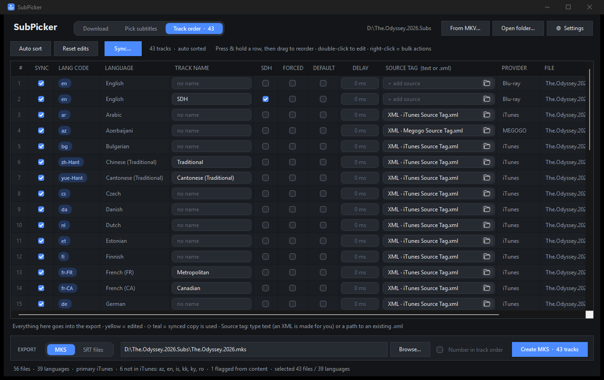
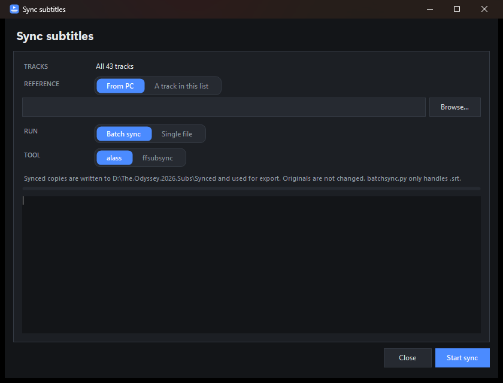

<div align="center">


# SubPicker

**A Windows desktop application for collecting, selecting, synchronizing and muxing subtitles.**

SubPicker brings subtitles from several streaming providers into one view, picks the best track for every language, arranges the tracks in MKVToolNix order with the correct names and flags, and exports them as a single Matroska subtitle file (MKS).


[**Download the latest release**](../../releases/latest)


</div>

---

## Contents

- [Overview](#overview)
- [Workflow](#workflow)
- [Features](#features)
  - [Download](#1-download)
  - [Pick subtitles](#2-pick-subtitles)
  - [Extract from MKV](#3-extract-from-mkv)
  - [Track order](#4-track-order)
  - [Source tags](#5-source-tags)
  - [Sync](#6-sync)
  - [Export](#7-export)
- [Installation](#installation)
- [Requirements](#requirements)
- [Settings](#settings)
- [Privacy and security](#privacy-and-security)
- [Building from source](#building-from-source)
- [FAQ](#faq)

---

## Overview

Subtitles for a single title are often spread across several releases, one per provider (iTunes, Netflix, Amazon, HBO Max, Disney+ …), each with a different set of languages, SDH versions and forced tracks. Combining them by hand means comparing folders, renaming files, setting language codes, track names and flags one by one, and getting the order right in MKVToolNix.

SubPicker handles this in one place:

| Step | What SubPicker does |
|---|---|
| **Collect** | Downloads subtitle folders from your subtitle site, opens local folders, or extracts the tracks from an existing MKV. |
| **Select** | Groups every subtitle by language and provider, and picks the best one per language from your preferred provider order. |
| **Arrange** | Sorts the tracks the way MKVToolNix lists them and fills in the language codes, track names and SDH / forced / default flags. |
| **Synchronize** | Corrects timing against a video, an audio track or a correctly timed subtitle with alass or ffsubsync. |
| **Export** | Writes one MKS file with all tracks, names, flags, delays and Source tags, or plain subtitle files. |

## Workflow

1. **Get the subtitles.** Search your subtitle site on the **Download** page, open a folder with **Open folder…**, or extract tracks with **From MKV…**. You can also drag files, folders or an MKV onto the window.
2. **Choose the tracks.** On **Pick subtitles**, set your provider priority and select the files you want. **Auto-select by priority** does this in one click.
3. **Review the result.** On **Track order**, check the order, language codes, names, flags, delays and Source tags, and edit anything directly in the table.
4. **Sync if needed.** Open **Sync…**, choose a reference, and sync the ticked tracks.
5. **Export.** Choose **MKS** or **SRT files** in the export bar and click **Export**.

---

## Features

### 1. Download

Search a [copyparty](https://github.com/9001/copyparty)-based subtitle site and download complete subtitle folders.

- **Search** by TMDB id (`1698863`), IMDb id (`tt1234567`) or title.
- **Results** are grouped by title. Each folder shows how many files it contains, its size and its location on the site.
- **Expandable tree.** Click **▶** on a folder to see its provider sub-folders, and again on a provider to see every subtitle file with its language, SDH / FORCED markers and size. Click **▼** to collapse it again.
- **Download & extract.** Tick the folders you need and SubPicker downloads them, unpacks every archive with 7-Zip or WinRAR (including archives inside archives), and loads the result.
- **Remembers your folder.** The last **Download to** location is kept for the next session.
- **Learns providers.** New provider codes are picked up from the site's folder names (for example `BB` → *Blockbuster*), so they are named correctly from then on.

### 2. Pick subtitles

All subtitles in the current folder, grouped by language, with one row per file.

- **Provider priority.** The side panel lists every provider found. The first one is the *primary* provider (iTunes by default). **Press and hold** a provider and drag it to change the order. **Double-click** a provider to show only its files.
- **Status at a glance.** Languages missing from the primary provider are shown in **orange**. Available files are shown in **green**.
- **Filters.** Show *All languages*, only languages *Missing from primary*, or only those *in primary*.
- **List order.** *Missing first*, or *MKV order* (English first, then A–Z).
- **Selection tools.** *Auto-select by priority* picks the best file for every language. *Select none* clears the selection. *Expand* / *Collapse* open or close all languages. Click a file to tick it, or tick the box on a language row to select every file in it.
- **Automatic SDH and forced detection.** Detection reads the subtitle text, not just the file name. Files detected this way are marked **auto**.
  - **SDH** is recognized from sound descriptions such as `[door slams]` or `(sighs)`. Music notes alone don't count.
  - **Forced** tracks are recognized by their low line count: under 20 % of the median for that folder.
  - For **PGS** (`.sup`) image subtitles, the forced flag stored inside the file is read.
- **More sources.** Use *Add subtitle files…*, *From MKV…*, or drag subtitle files (`.srt`, `.ass`, `.ssa`, `.vtt`, `.sup`), folders or an MKV onto the window.
- **Quick access.** Double-click a file to open it in its default program.

### 3. Extract from MKV

Pull subtitle tracks out of an existing MKV or MKS with mkvextract.

- One compact card per track shows the language, track name, codec, line or image count, size, and **DEFAULT / FORCED / SDH** badges.
- **All** / **None** buttons for quick selection.
- **Save to** an editable path, with **Browse…**, **Next to MKV** (a new folder named after the file) and **Open folder**.
- The extracted tracks are loaded straight into *Pick subtitles*, next to the downloaded ones.

<div align="center"></div>

### 4. Track order

The final list of tracks exactly as it will be exported. Every column can be reviewed and changed.

| Column | Description |
|---|---|
| **#** | Position in the output file. |
| **SYNC** | Whether the track is included in the next sync. Click the header to tick all. |
| **LANG CODE** | BCP 47 language code (`en`, `pt-BR`, `zh-Hant`, `es-419` …). Editable. |
| **LANGUAGE** | Language name, for reference. |
| **TRACK NAME** | The name shown in players. Filled in automatically and editable. |
| **SDH / FORCED / DEFAULT** | The Matroska *hearing impaired*, *forced display* and *default track* flags. Click to toggle. |
| **DELAY** | A time shift in milliseconds, applied at export. |
| **SOURCE TAG** | The Source tag for this track: free text, or the path to an XML file (see [Source tags](#5-source-tags)). |
| **PROVIDER / FILE** | Where the track came from. Double-click to open the file. |

- **MKVToolNix ordering.** *Auto sort* puts English first, then the other languages A–Z. Regional variants follow a fixed order: Castilian → Latin American Spanish, European → Brazilian Portuguese, Metropolitan → Canadian → Belgian → Swiss French, Simplified → Traditional Chinese, and so on. Normal, SDH and forced versions of a language stay together.
- **Automatic track names.** Names such as *SDH*, *Forced*, *European*, *Brazilian*, *Latin American*, *Canadian*, *Traditional* or *Alternate* are filled in from the language code and flags. Languages that don't need a name, such as Serbian Latin and Cyrillic, are left empty.
- **Inline editing.** Double-click a cell to edit it in place. **Enter** saves the change and **Esc** cancels it. Edited cells are highlighted in yellow. *Reset edits* restores the automatic values.
- **Drag to reorder.** Press and hold a row, then drag it to a new position. Several selected rows move together.
- **Bulk actions** (right-click on the selected rows):
  - Copy the cell, the track name or the file name (**Ctrl+C** also works).
  - Tick or untick tracks for sync, or undo a sync.
  - Type a Source text, choose an existing tags XML, or use the provider as the Source (for example *iTunes WEB-DL*).
  - Set one delay for all selected tracks.
  - Reset edits.

<div align="center"></div>

### 5. Source tags

A Source tag is a Matroska tag stored with a track to record where the subtitle came from, for example *iTunes WEB-DL* or *Netflix*. SubPicker can add one to every track in three ways.

#### a) Automatic, from a tags folder

Keep one XML file per provider in a folder of your choice, named after the provider code used in the subtitle file names:

```
D:\TAGS\
├─ iT Source Tag.xml       → used for  Movie.2024.iT.WEB.en.srt
├─ NF Source Tag.xml       → used for  Movie.2024.NF.WEB-DL.fr.srt
├─ AMZN Source Tag.xml     → used for  Movie.2024.AMZN.WEBRip.de.srt
└─ HMAX Source Tag.xml     → used for  Movie.2024.HMAX.WEB.es.srt
```

- Set the folder under **Settings → Source tags → Tags folder**.
- Every track whose file name contains a matching code gets the right XML attached automatically.
- New XML files added to the folder are found by themselves. The folder is re-checked whenever you return to SubPicker or open *Track order*.
- The table in Settings lists each code with its XML file. Use **+ Add new…**, **Change…** or **Remove** to add a code by hand or point it to a different XML. A row shown in red means its XML file no longer exists.

<div align="center"></div>

#### b) Typed by hand

You don't need an XML file at all. Type any text into the **SOURCE TAG** cell, for example `iTunes WEB-DL`, or use *right-click → Type Source text for selected tracks…* to set it on many tracks at once. At export, SubPicker creates a valid Matroska tags XML for you:

```xml
<?xml version="1.0" encoding="UTF-8"?>
<Tags>
  <Tag>
    <Targets />
    <Simple>
      <Name>Source</Name>
      <String>iTunes WEB-DL</String>
    </Simple>
  </Tag>
</Tags>
```

#### c) From the provider name, or an existing XML

- *Right-click → Use provider as Source* fills in the provider's name and release type (for example *iTunes WEB-DL*) for the selected tracks.
- *Right-click → Choose existing tags XML…* attaches any Matroska tags file you already have.

### 6. Sync

Correct subtitle timing before exporting.

- **Reference.** Choose one of these:
  - **From PC**: a video (`.mkv`, `.mp4`, `.m2ts` …), an audio track (`.dts`, `.dtsma`, `.thd`, `.ac3`, `.eac3`, `.flac`, `.wav`, `.mp3`, `.opus` and many more), or a correctly timed subtitle.
  - **A track in this list**: one of the selected subtitles, for example the iTunes English track.
- **Tools.** [alass](https://github.com/kaegi/alass) or [ffsubsync](https://github.com/smacke/ffsubsync).
- **Automatic fallback.** If the reference is something alass can't read, SubPicker switches to ffsubsync for that run and explains why in the log. This covers raw DTS / DTS-HD MA / TrueHD streams, which have no stored duration, WebVTT subtitles, and files without an audio track.
- **Run mode.** *Batch sync* runs all tracks in one pass through `batchSync.py`. *Single file* syncs each track separately and shows its result.
- **Track selection.** The **SYNC** column decides which tracks are synced. Selecting rows never changes it.
- **Safe by design.** Synced copies are written to a `Synced` folder, and the originals are never modified. Synced tracks are marked **⟳** in teal, and *Undo sync* goes back to the original.
- **PGS** image subtitles are skipped automatically. Use the **DELAY** column to shift them instead.

<div align="center"></div>

### 7. Export

- **MKS.** A single Matroska subtitle file created with mkvmerge. It contains every track in order, with its language, name, SDH / forced / default flags, delay and Source tag.
- **SRT files.** Plain copies of the selected files, optionally numbered in track order (`01.`, `02.` …), with delays applied. PGS files are shifted as well.
- **Output location.**
  - When you opened a folder yourself, SubPicker exports into that folder.
  - For downloaded subtitles, it uses the last export folder you chose.
  - **Browse…** always lets you pick a different location.

---

## Installation

1. Download **`SubPicker.exe`** from the [latest release](../../releases/latest).
2. Place it in any folder and run it. No installer or setup is required.
3. Open **⚙ Settings** once. Enter your subtitle site address and login, and confirm the tool paths. Most of them are found automatically.

## Requirements

| Component | Purpose | Detection |
|---|---|:---:|
| Windows 10 or 11 | Operating system | – |
| .NET Framework 4.8 | Runtime, included with Windows 10 and 11 | – |
| [MKVToolNix](https://mkvtoolnix.download/) | MKS export, extracting from MKV | Automatic |
| [7-Zip](https://www.7-zip.org/) or WinRAR | Unpacking downloaded archives | Automatic |
| [alass](https://github.com/kaegi/alass) and/or [ffsubsync](https://github.com/smacke/ffsubsync) | Subtitle synchronization | Automatic if on PATH |
| Python with `batchSync.py` | Batch sync (optional) | Next to the exe |

Only the components for the features you use are needed. Anything not detected can be set in **Settings**.

## Settings

| Section | Options |
|---|---|
| **Tools** | Paths to mkvextract (mkvmerge is taken from the same folder), batchSync.py, alass, ffsubsync, 7-Zip and WinRAR. A ✔ or ✘ shows whether each one was found. *Auto-detect tools* fills them in again. |
| **Subtitle site** | Site URL, username and password. |
| **Folders** | Default download folder. |
| **Source tags** | Tags folder, plus the table of provider codes and their XML files. |

## Privacy and security

- All settings are stored in **`settings.json` next to `SubPicker.exe`**. Nothing is written to the registry or to your user profile, so the application is fully portable.
- The site password is encrypted with **Windows DPAPI** and can only be read by your Windows account.
- A new copy of `SubPicker.exe` always starts with empty settings. To share the application, share only the exe, never your `settings.json`.
- SubPicker only connects to the subtitle site you configure.

## Building from source

Requires the [.NET SDK](https://dotnet.microsoft.com/download). The built application targets .NET Framework 4.8.

```powershell
dotnet build SubPicker.csproj -c Release
```

The output is a single file: `bin\Release\net48\SubPicker.exe`.

```
src/
├─ Core.cs          Subtitle parsing, SDH / forced / PGS detection, languages, track names, providers
├─ Services.cs      Settings, tool detection, process handling, subtitle site client, archives
├─ MainForm.cs      Main window: Download, Pick subtitles, Track order, export bar
├─ Actions.cs       Settings, downloading, MKV extraction, sync and export
├─ UI.cs            Dark theme and custom controls
└─ FolderPicker.cs  Native Windows folder picker
```

## FAQ

<details>
<summary><b>Does SubPicker need anything installed?</b></summary>

The application itself only needs .NET Framework 4.8, which is part of Windows 10 and 11. External tools (MKVToolNix, 7-Zip, alass, ffsubsync) are only needed for the features that use them.
</details>

<details>
<summary><b>Why is a track named "European" or "Latin American"?</b></summary>

Track names come from the regional language code: `pt-PT` → *European*, `pt-BR` → *Brazilian*, `es-419` → *Latin American*, `fr-CA` → *Canadian*, `zh-Hant` → *Traditional*. Any name can be changed in the **TRACK NAME** column.
</details>

<details>
<summary><b>Why is a Source tag row shown in red in Settings?</b></summary>

The XML file it points to no longer exists. Point it to a new file with **Change…**, or delete the row with **Remove**.
</details>

<details>
<summary><b>Why did the sync switch from alass to ffsubsync?</b></summary>

alass can't use some references, such as raw DTS / TrueHD audio, which has no stored duration, or WebVTT subtitles. SubPicker detects this and uses ffsubsync instead. The reason is shown in the sync log. A DTS track inside an `.mka` or `.mkv` works with alass.
</details>

<details>
<summary><b>Where are my settings stored?</b></summary>

In `settings.json`, in the same folder as `SubPicker.exe`. Delete it to start with default settings.
</details>
