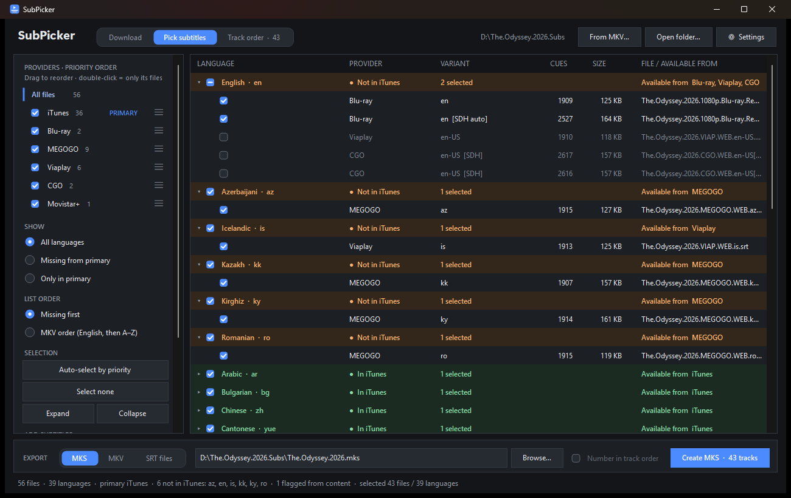
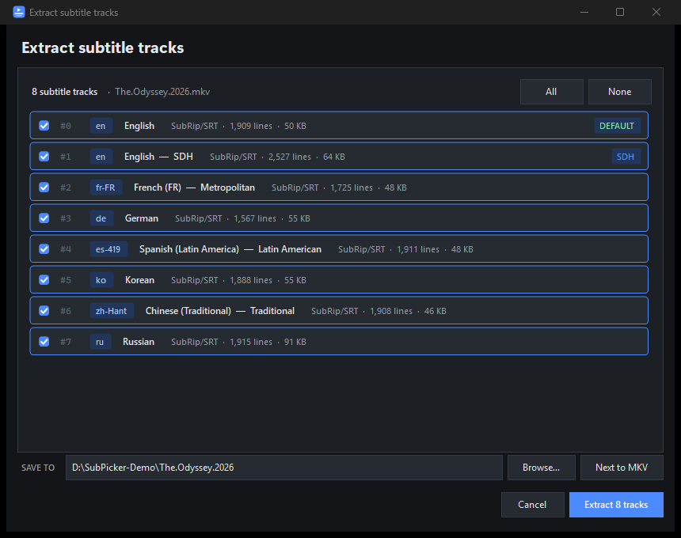
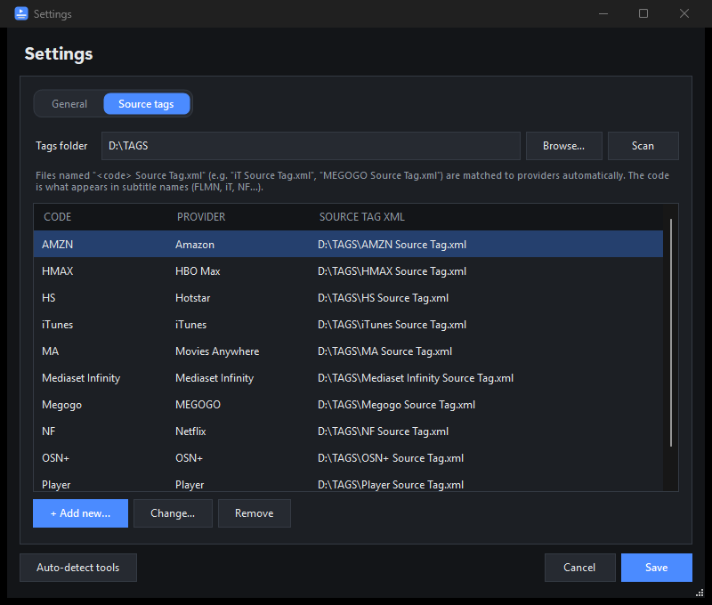

<div align="center">


# SubPicker

**Pick the best subtitle for every language from every source, put the tracks in perfect MKVToolNix order and mux them into one MKS.**


### [⬇️ Download the latest SubPicker.exe](../../releases/latest)



</div>

---

## ✨ Features

### 🔎 Download
- Search your subtitle site by **TMDB / IMDb id** (`1698863`, `tt1234567`) or by title.
- Tick the folders you want: SubPicker downloads, unpacks (7-Zip / WinRAR, nested archives too) and opens them.
- Learns new provider names from the site's folder names (e.g. `BB` → *Blockbuster*).

### 🎯 Pick subtitles
- Every language in one list, with a **primary provider** (iTunes by default) and the others filling the gaps.
- Orange = missing from the primary, green = available, so you see at a glance what you still need.
- **SDH** and **forced** tracks are detected from the subtitle text itself, plus forced flags inside PGS (`.sup`).
- Provider priority list: **press and hold to drag**, double-click a provider to see only its files.
- Drag & drop subtitle files, folders or an MKV straight onto the window.

### 📦 From MKV
- Pull the subtitle tracks out of **any MKV** into a folder you choose (by default a new folder named after the MKV).
- One compact card per track with language, name, line count, size and DEFAULT / FORCED / SDH badges.

<div align="center"></div>

### 🧩 Track order
- Tracks are sorted the way MKVToolNix lists them: English first, then languages A–Z, regional variants in the right order (Castilian → Latin American, Simplified → Traditional…).
- Track names are filled in for you (*SDH*, *European*, *Canadian*, *Traditional*, *Alternate*…).
- Edit language, name, SDH / forced / default flags and delay right in the table.
- **Press and hold a row, then drag** to reorder - several selected rows move together.
- **Source tags**: per-provider XML files (e.g. `iT Source Tag.xml`) are attached automatically; or type a text and the XML is made for you.

<div align="center"></div>

### 🏷️ Source tags
- Save one XML per provider as `<CODE> Source Tag.xml` (e.g. `HMAX Source Tag.xml`) in your tags folder - the code is the one in the subtitle names.
- SubPicker finds new files by itself and attaches them to every matching track.

<div align="center"></div>

### ⏱️ Sync
- Sync against a video / audio / subtitle file **from your PC**, or against one of the tracks.
- **alass** or **ffsubsync**, as a whole batch (via `batchSync.py`) or file by file.
- A **SYNC** tick column decides which tracks are synced - clicking rows never changes it.
- PGS image subtitles are left out automatically (use the delay column for them).

<div align="center"></div>

### 💾 Export
- **MKS** through mkvmerge, with languages, names, flags, delays and Source tags.
- Or plain **SRT files**, optionally numbered in track order, with delays applied.

---

## 🚀 Getting started

1. Download **`SubPicker.exe`** from the [latest release](../../releases/latest) and put it in any folder.
2. Run it - nothing to install.
3. Open **⚙ Settings** once: enter your subtitle site and login, and check the tool paths (most are found automatically).

That's it. Open a subtitle folder, download one, or drop an MKV onto the window.

## 🧰 Tools it works with

| Tool | Used for | Found automatically |
|---|---|:---:|
| [MKVToolNix](https://mkvtoolnix.download/) | MKS export, extracting from MKV | ✅ |
| [7-Zip](https://www.7-zip.org/) or WinRAR | Unpacking downloads | ✅ |
| [alass](https://github.com/kaegi/alass) or [ffsubsync](https://github.com/smacke/ffsubsync) | Sync | ✅ if on PATH |
| Python + `batchSync.py` | Batch sync (optional) | `batchSync.py` next to the exe |

Anything not found can be set in **Settings**.

## 🔒 Settings & privacy

- Settings are saved in **`settings.json` next to `SubPicker.exe`** - the app is fully portable.
- The site password is encrypted with Windows DPAPI, so it only works for your Windows account.
- A fresh copy of the exe always starts with empty settings: to share the app, send **only `SubPicker.exe`**, never your `settings.json`.

## 🛠️ Build from source

Needs the [.NET SDK](https://dotnet.microsoft.com/download) (the result only needs .NET Framework 4.8, which ships with Windows).

```powershell
dotnet build SubPicker.csproj -c Release
```

The app is the single file `bin\Release\net48\SubPicker.exe`.

```
src/
├─ Core.cs          subtitle parsing, SDH / forced / PGS detection, languages, providers
├─ Services.cs      settings, tool detection, processes, subtitle site, archives
├─ MainForm.cs      main window: Download, Pick subtitles, Track order, export bar
├─ Actions.cs       Settings, download, From MKV, sync and export
├─ UI.cs            dark theme and controls
└─ FolderPicker.cs  modern folder picker
```

## ❓ FAQ

<details>
<summary><b>Does it need .NET or anything else installed?</b></summary>

No. It uses .NET Framework 4.8, which is part of Windows 10 and 11.
</details>

<details>
<summary><b>Why is it a single small exe?</b></summary>

The app is compiled C# using the .NET Framework that Windows already has, so nothing has to be bundled with it.
</details>

<details>
<summary><b>Where are my settings?</b></summary>

In `settings.json` in the same folder as `SubPicker.exe`. Delete it to start fresh.
</details>
